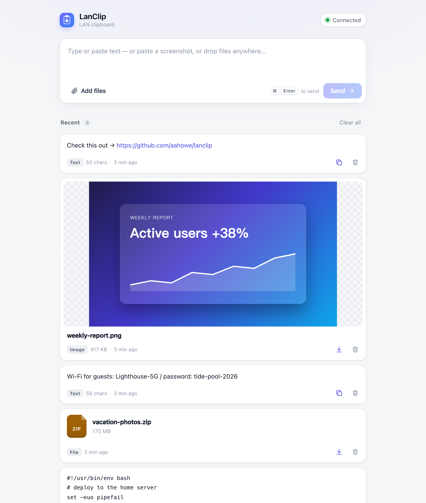
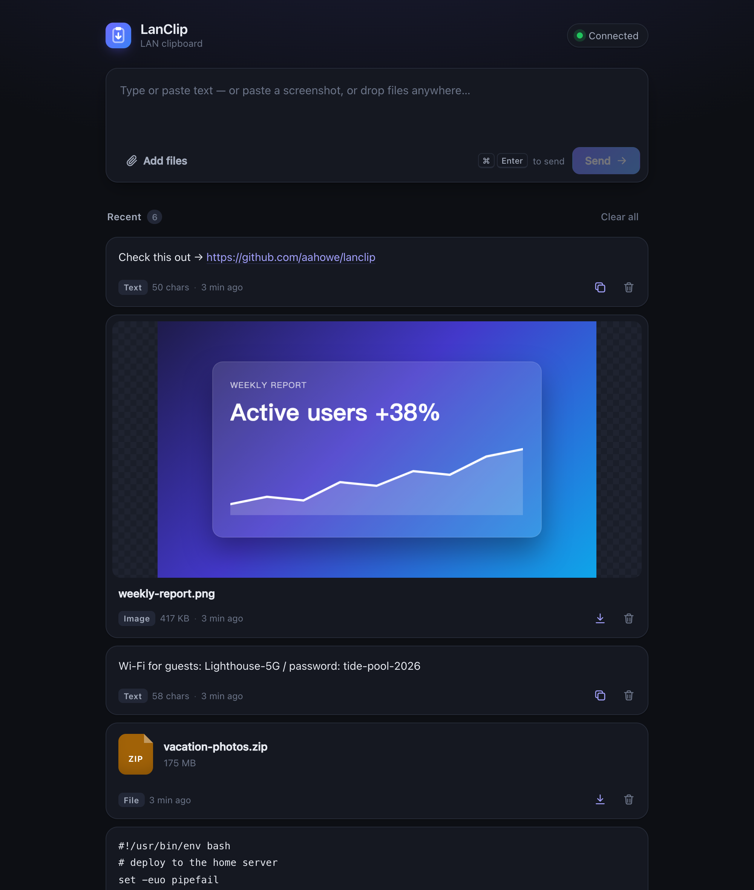

<p align="center">
  
</p>

<h1 align="center">LanClip</h1>

<p align="center">
  A tiny, self-hosted clipboard for your local network.<br>
  Drop text, images or files on one device — pick them up on any other.
</p>

<p align="center">
  <a href="https://github.com/aahowe/lanclip/actions/workflows/ci.yml"></a>
  <a href="https://github.com/aahowe/lanclip/releases"></a>
  <a href="LICENSE"></a>
  <br>
  English · <a href="README.zh-CN.md">简体中文</a>
</p>

<p align="center">
  
  
</p>

## Why

Moving a link from your phone to your laptop, or a screenshot from your laptop to your desktop, shouldn't need a chat app, a cloud account or a pairing dance. LanClip is one web page on a server you already own: open it anywhere on your network, drop something in, open it somewhere else, take it out. The server holds the content, so the two devices never need to be online at the same time.

## Features

- **Text** — one-click copy (works over plain HTTP, no HTTPS needed), long text folds, links are clickable, code is shown in monospace
- **Images** — paste a screenshot with <kbd>⌘/Ctrl</kbd>+<kbd>V</kbd> anywhere on the page, see a thumbnail, click for full size
- **Files** — drag & drop or pick any number of files of any type; parallel uploads with progress and speed; resumable downloads (HTTP Range)
- **Real-time** — every open page updates instantly (Server-Sent Events) and shows how many devices are online
- **Looks good everywhere** — designed for phones and desktops, light and dark mode, English and Chinese UI picked from the browser language
- **Tiny** — a single static Go binary with the UI embedded, standard library only, zero dependencies; the Docker image is about 6 MB
- **Tidy** — items expire automatically (7 days by default) and the list is capped, so the disk never fills up

<p align="center">
  
  &nbsp;
  
</p>

## Quick start

### Docker Compose (recommended)

```bash
mkdir lanclip && cd lanclip
curl -O https://raw.githubusercontent.com/aahowe/lanclip/master/compose.yaml
docker compose up -d
```

Then open `http://<server-ip>:9501` on any device on your network. Data lives in `./data`.

### Docker

```bash
docker run -d --name lanclip --restart unless-stopped \
  -p 9501:9501 -v "$PWD/data:/data" ghcr.io/aahowe/lanclip:latest
```

Images are published for `linux/amd64`, `linux/arm64` and `linux/arm/v7`, so a Raspberry Pi or most NAS boxes work too.

### Binary

Download the archive for your platform from [Releases](https://github.com/aahowe/lanclip/releases), unpack it and run:

```bash
./lanclip
```

### From source

```bash
git clone https://github.com/aahowe/lanclip.git && cd lanclip
go build -o lanclip . && ./lanclip
```

Requires Go 1.24 or newer.

## Configuration

All settings are environment variables.

| Variable | Default | Description |
| --- | --- | --- |
| `LANCLIP_ADDR` | `:9501` | Listen address |
| `LANCLIP_DATA` | `./data` (`/data` in Docker) | Where items and files are stored |
| `LANCLIP_TTL` | `168h` | How long items are kept, as a Go duration (`30m`, `24h`, …). `0` keeps them forever |
| `LANCLIP_MAX_ITEMS` | `200` | Maximum number of items; the oldest are removed beyond this |
| `LANCLIP_MAX_FILE_MB` | `4096` | Maximum size of a single file, in MiB |

## Security

LanClip has **no authentication**: anyone who can reach the port can read, upload and delete everything. It is meant for a trusted home or office network. Do not expose it directly to the internet. If you need remote access, put it behind a VPN (WireGuard, Tailscale) or a reverse proxy that adds authentication.

Uploaded HTML, SVG and other active content is always served as a download, never rendered, so a file can't run scripts in the page.

## API

Everything the UI does is available over plain HTTP, which makes LanClip easy to script.

| Method | Path | Description |
| --- | --- | --- |
| `GET` | `/api/items` | List all items (newest first) and server limits |
| `POST` | `/api/text` | Add text. Body: `{"text": "..."}` |
| `POST` | `/api/files?name=<filename>` | Upload a file. Body: the raw file bytes |
| `GET` | `/api/files/{id}` | Fetch a file. Add `?dl=1` to force a download |
| `DELETE` | `/api/items/{id}` | Delete one item |
| `DELETE` | `/api/items` | Delete everything |
| `GET` | `/api/events` | Server-Sent Events stream (`add`, `remove`, `presence`) |

```bash
# send text
curl -X POST http://lanclip.local:9501/api/text -d '{"text":"hello from the terminal"}'

# send a file
curl -X POST "http://lanclip.local:9501/api/files?name=report.pdf" --data-binary @report.pdf

# grab the latest text
curl -s http://lanclip.local:9501/api/items | jq -r '[.items[] | select(.kind=="text")][0].text'
```

## Development

```bash
go run .          # serves on :9501 with ./data
go test -race ./...
```

The UI is plain HTML, CSS and JavaScript in [`web/`](web), embedded into the binary at build time. No build step, no framework.

## License

[MIT](LICENSE)
