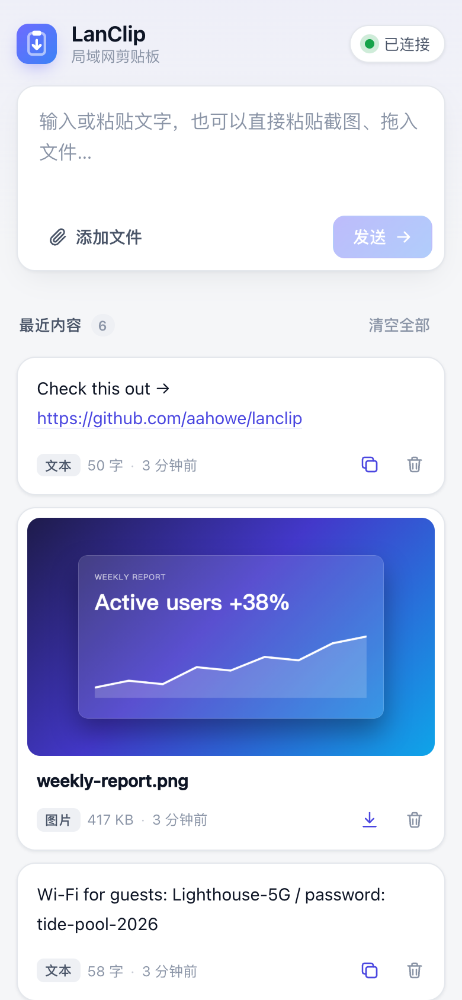
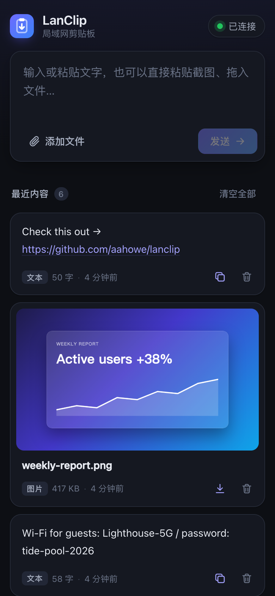

<p align="center">
  
</p>

<h1 align="center">LanClip</h1>

<p align="center">
  极简的自托管局域网剪贴板。<br>
  在一台设备上放进文字、图片或文件，在任意另一台设备上取出来。
</p>

<p align="center">
  <a href="https://github.com/aahowe/lanclip/actions/workflows/ci.yml"></a>
  <a href="https://github.com/aahowe/lanclip/releases"></a>
  <a href="LICENSE"></a>
  <br>
  <a href="README.md">English</a> · 简体中文
</p>

<p align="center">
  
  &nbsp;
  
</p>

## 为什么做它

把手机上的链接发到电脑，把电脑上的截图传到另一台电脑，不应该需要登录聊天软件、注册云服务或者配对设备。LanClip 就是放在你自己服务器上的一个网页：在局域网里任意设备上打开，放进去；换一台设备打开同一个页面，取出来。内容由服务器中转保存，两台设备不需要同时在线。

## 功能

- **文字**：一键复制（纯 HTTP 下同样可用，不需要 HTTPS），长文本自动折叠，链接可点击，代码用等宽字体显示
- **图片**：在页面任意位置 <kbd>⌘/Ctrl</kbd>+<kbd>V</kbd> 粘贴截图，显示缩略图，点击查看大图
- **文件**：拖拽或选择任意类型、任意数量的文件，并行上传并显示进度和速度，下载支持断点续传（HTTP Range）
- **实时同步**：所有打开的页面即时更新（SSE），并显示在线设备数
- **好看、好用**：适配手机和电脑，支持浅色 / 深色模式，界面语言按浏览器自动切换中文或英文
- **轻量**：单个静态 Go 二进制，前端打包在内，只用标准库、零依赖，Docker 镜像约 6 MB
- **自动清理**：内容默认保留 7 天，条数有上限，不会把硬盘塞满

## 快速开始

### Docker Compose（推荐）

```bash
mkdir lanclip && cd lanclip
curl -O https://raw.githubusercontent.com/aahowe/lanclip/master/compose.yaml
docker compose up -d
```

然后在局域网内任意设备上打开 `http://<服务器 IP>:9501`。数据保存在 `./data`。

### Docker

```bash
docker run -d --name lanclip --restart unless-stopped \
  -p 9501:9501 -v "$PWD/data:/data" ghcr.io/aahowe/lanclip:latest
```

镜像提供 `linux/amd64`、`linux/arm64`、`linux/arm/v7` 三种架构，树莓派和大多数 NAS 都能直接运行。

### 二进制

从 [Releases](https://github.com/aahowe/lanclip/releases) 下载对应平台的压缩包，解压后运行：

```bash
./lanclip
```

### 从源码构建

```bash
git clone https://github.com/aahowe/lanclip.git && cd lanclip
go build -o lanclip . && ./lanclip
```

需要 Go 1.24 及以上版本。

## 配置

所有配置都通过环境变量设置。

| 变量 | 默认值 | 说明 |
| --- | --- | --- |
| `LANCLIP_ADDR` | `:9501` | 监听地址 |
| `LANCLIP_DATA` | `./data`（Docker 中为 `/data`） | 内容和文件的存储目录 |
| `LANCLIP_TTL` | `168h` | 内容保留时长，Go duration 格式（`30m`、`24h` 等），`0` 表示永久保留 |
| `LANCLIP_MAX_ITEMS` | `200` | 最多保留条数，超出后删除最旧的 |
| `LANCLIP_MAX_FILE_MB` | `4096` | 单个文件大小上限（MiB） |

## 安全

LanClip **没有任何认证**：能访问端口的人都可以查看、上传和删除全部内容。它面向可信的家庭或办公局域网，请不要直接暴露到公网。如果需要远程访问，请通过 VPN（WireGuard、Tailscale）或带认证的反向代理。

上传的 HTML、SVG 等可执行内容一律作为下载返回，不会在页面中渲染，文件无法在页面里执行脚本。

## API

页面上的所有操作都可以直接通过 HTTP 完成，方便写脚本。

| 方法 | 路径 | 说明 |
| --- | --- | --- |
| `GET` | `/api/items` | 列出全部内容（新的在前）和服务器限制 |
| `POST` | `/api/text` | 发送文字，请求体 `{"text": "..."}` |
| `POST` | `/api/files?name=<文件名>` | 上传文件，请求体为文件原始内容 |
| `GET` | `/api/files/{id}` | 获取文件，加 `?dl=1` 强制下载 |
| `DELETE` | `/api/items/{id}` | 删除一条 |
| `DELETE` | `/api/items` | 清空全部 |
| `GET` | `/api/events` | SSE 实时事件流（`add`、`remove`、`presence`） |

```bash
# 发送文字
curl -X POST http://lanclip.local:9501/api/text -d '{"text":"来自终端的问候"}'

# 发送文件
curl -X POST "http://lanclip.local:9501/api/files?name=report.pdf" --data-binary @report.pdf

# 取最新一条文字
curl -s http://lanclip.local:9501/api/items | jq -r '[.items[] | select(.kind=="text")][0].text'
```

## 开发

```bash
go run .          # 在 :9501 启动，数据存在 ./data
go test -race ./...
```

前端是 [`web/`](web) 目录下的原生 HTML、CSS 和 JavaScript，构建时嵌入二进制，没有构建步骤，也没有框架。

## 许可证

[MIT](LICENSE)
